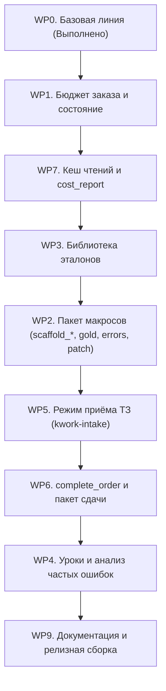

# План реализации: Развитие проекта `kwork-guard`

> **Статус:** WP0 завершён успешно (9/9 тестов зеленые, схемы верифицированы). WP8 исключён по требованию. Добавлен расширенный пакет макросов для экстремальной экономии токенов.

---

## 1. Архитектура и структура решения

```
kwork-guard/
├── edt_guard.py            # Ядро прокси: FastAPI + HTTP streamable MCP (порт 8766)
├── config.json             # Конфигурация: бюджеты, лимиты, пути, профили
├── verified_schemas.json   # Подтверждённые схемы 10 ключевых инструментов EDT-MCP (WP0)
├── gold_templates/         # Золотые эталонные проекты (WP2) для мгновенного клонирования
│   ├── vpf_standard/       # Готовая ВПФ под БСП 2/3
│   └── report_standard/    # Готовый внешний отчет СКД
├── library/                # Библиотека эталонных BSL/Query сниппетов (WP3)
│   ├── index.json          # Метаданные и теги сниппетов
│   ├── bsl/                # Файлы BSL-фрагментов (status: draft/verified)
│   └── query/              # Тексты запросов 1С
├── templates/              # Шаблоны документов и пакета сдачи (WP5, WP6)
│   ├── brief.md            # Структурированный бриф заказа
│   ├── brief.schema.json   # JSON-схема валидации брифа
│   ├── instructions_client.md # Инструкция заказчику по подключению ВПФ
│   ├── message_kwork.md    # Сообщение о сдаче заказа
│   └── checklist_manual.md # Чек-лист проверки в тестовой базе
├── state/                  # Состояние заказов и журнал событий (в .gitignore)
│   ├── <order_id>.json     # Метрики и бюджет конкретного заказа
│   └── events.jsonl        # Нормализованные ошибки для еженедельных уроков (WP4)
├── tools/                  # Утилиты автоматизации и отчётности
│   ├── discover.py         # Разведка схем EDT-MCP (WP0, готов)
│   ├── cost_report.py      # Отчёт по токенам и затратам (WP7)
│   ├── library_verify.py   # Верификация сниппетов (WP3)
│   ├── weekly_lessons.py   # Анализатор ошибок и генератор уроков (WP4)
│   └── validate_brief.py   # Валидатор брифа заказа (WP5)
├── tests/                  # Набор тестов (pytest + mock-upstream)
│   ├── mock_upstream.py    # Мок-сервер EDT (JSON, SSE, 404, задержки)
│   ├── test_baseline.py    # Базовые тесты прокси (WP0, 9/9 пройдены)
│   └── test_*.py           # Тесты для каждого пакета работ
├── .roomodes               # Режимы Roo Code: kwork-intake, vpf, report, ext
├── .roo/rules-*/           # Компактные правила для каждого режима
├── mcp_configs/            # Конфигурации mcp.json под каждый профиль
├── start_guard.bat         # Запуск прокси
└── new_order.bat           # Быстрое создание папки нового заказа
```

---

## 2. Итоги WP0 (Базовая линия и разведка)

1. **Разведка по реальному EDT-MCP (`tools/discover.py`):**
   * Выгружены и зафиксированы схемы 10 ключевых инструментов в `verified_schemas.json`.
   * Сверены и подтверждены все 5 констант (`BUILD_OUTPUT_ARG`, `ERRORS_ARGS`, `MODULE_PATH_TMPL`, `EXTERNAL_OBJECT_TMPL`, `TEMPLATE_FQN_TMPL`).
   * Проверен код выхода 2 при недоступном EDT.
2. **Базовое тестирование (`tests/test_baseline.py`):**
   * Все 9 тестов пройдены успешно (0.72с): инициализация, профили, отбой пустых properties, авто-summary, антицикл, SSE, 404 recovery, scaffold_vpf, build_and_check.

---

## 3. Пакет макросов для экстремальной экономии токенов

Главный источник расхода токенов — многократная пересылка контекста при пошаговых вызовах (каждый вызов шлет 15-30k токенов префикса).
Мы заменяем 8-12 последовательных вызовов на **3 сквозных макроса на весь заказ**:

```
Типовой заказ (традиционно: 8-12 шагов, ~200k-350k токенов):
[create_project] -> [create_metadata] -> [modify_metadata] -> [write_module] -> [validate_query] -> [get_project_errors (15k токенов таблица!)] -> [write_module fix] -> [build] -> [write client msg]

С макросами kwork-guard (всего 2-3 вызова, ~20k-40k токенов, экономия 85-90%!):
Шаг 1: [scaffold_vpf ИЛИ bootstrap_gold] (создание всей структуры за 1 вызов)
Шаг 2 (если нужна точечная правка): [patch_method] + [get_critical_errors] (только критичные ошибки, 3 строки вместо 500)
Шаг 3: [complete_order] (проверка -> компиляция .epf -> генерация сообщения клиенту и git commit)
```

### Состав нового пакета макросов:

1. **`scaffold_vpf` (Ультра-ВПФ)**:
   * Принимает параметры шапки, колонок, код заполнения.
   * Проверяет вложенные запросы до записи.
   * Создает проект, макет с областями Шапка/Строка/Подвал и ObjectModule с БСП за 1 вызов.
2. **`scaffold_report` (СКД-отчеты)**:
   * Принимает запрос, группировки и поля.
   * Предварительно валидирует запрос через `validate_query`.
   * Создает проект отчета, схему `.dcs` и модуль регистрации отчета в БСП за 1 вызов.
3. **`scaffold_processor` (Внешняя обработка)**:
   * Создает внешнюю обработку заполнения ТЧ или пакетной выгрузки данных со всеми реквизитами и БСП `СведенияОВнешнейОбработке` за 1 вызов.
4. **`bootstrap_gold` (Мгновенный старт из золотого эталона)**:
   * Локальное копирование готового проверенного проекта из `gold_templates/` в workspace EDT за 0 токенов (EDT-MCP даже не дергается). Модель сразу переходит к специфичной логике.
5. **`get_critical_errors` (Умный фильтр ошибок)**:
   * Вместо гигантской таблицы EDT на 500 строк (10 000+ токенов) с предупреждениями об отсутствии комментариев и стандартах оформления, отдает **только критичные синтаксические ошибки компиляции** (до 5 строк). Экономит до 15 000 токенов на каждом цикле проверки!
6. **`patch_method` (Хирургическая правка метода в расширении)**:
   * Для доработок типовых конфигураций: заменяет или навешивает `&После`/`&Вместо` на конкретный метод без выгрузки сотен строк окружающего модуля в контекст.
7. **`complete_order` (Финализация под ключ)**:
   * Объединяет `get_critical_errors` + `build_external_objects` + подготовку пакета сдачи (инструкция клиенту, сообщение для Kwork, локальный git коммит) в 1 вызов.

---

## 4. Обновленный план реализации по пакетам работ

Порядок реализации:
**WP1 (Бюджет) → WP7 (Кеш и логи) → WP3 (Сниппеты) → WP2 (Макросы + Gold) → WP5 (Приём ТЗ) → WP6 (Сдача заказа) → WP4 (Уроки) → WP9 (Релиз)**



### WP1. Бюджет заказа и состояние
* Отслеживание `order_id` (заголовок `X-Order-Id`, `projectName`, `default`).
* Персистентное состояние в `state/<order_id>.json`.
* Лимит вызовов (`max_calls_per_order: 25`), предупреждение при 80%, жесткая блокировка при 100% (кроме финализации).
* Локальные админ-эндпоинты `/admin/orders`.
* **Тесты:** `tests/test_wp1_budget.py`.

### WP7. Кеш чтений и журнал затрат
* In-memory кеш для `read_*`, `get_module_structure`, `list_*`, `get_metadata_*`.
* Инвалидация кеша проекта при любом успешном write-вызове.
* Утилита `tools/cost_report.py` (число вызовов, доля кеша, топ тяжелых вызовов, расчет стоимости).
* Ротация логов `guard_log.jsonl` (5 МБ x 3).
* **Тесты:** `tests/test_wp7_cache.py`.

### WP3. Библиотека эталонов (Сниппеты)
* Каталог `library/`: `index.json` + стартовые BSL/Query сниппеты (`draft`).
* Инструменты `library_list` и `library_get`.
* Интеграция `snippet_ids` в макросы.
* Утилита `tools/library_verify.py` (`--confirm`).
* **Тесты:** `tests/test_wp3_library.py`.

### WP2. Пакет макросов экстремальной экономии
* Реализация `scaffold_report` (СКД), `scaffold_processor` (обработки), `bootstrap_gold` (клонирование), `get_critical_errors` (сжатый отчет об ошибках), `patch_method` (хирургическая правка).
* Поддержка `dry_run: true` во всех макросах.
* **Тесты:** `tests/test_wp2_macros.py`.

### WP5. Режим приёма ТЗ (`kwork-intake`)
* Режим в `.roomodes` без MCP-инструментов (0 токенов на схемы инструментов!).
* `templates/brief.md` и `templates/brief.schema.json`.
* Скрипт `tools/validate_brief.py`.
* **Тесты:** `tests/test_wp5_brief.py`.

### WP6. Пакет сдачи и макрос `complete_order`
* Макрос `complete_order`: сборка артефакта, генерация инструкций, git коммит.
* Шаблоны `instructions_client.md`, `message_kwork.md`, `checklist_manual.md`.
* Проверка необработанных плейсхолдеров `{{...}}`.
* **Тесты:** `tests/test_wp6_delivery.py`.

### WP4. Файл уроков
* `state/events.jsonl` с нормализованными сигнатурами ошибок.
* Скрипт `tools/weekly_lessons.py` для группировки ошибок и формирования подсказок в `rules.md`.
* **Тесты:** `tests/test_wp4_lessons.py`.

### WP9. Документация и релиз
* Обновление `README.md`, `CHANGELOG.md`.
* Эндпоинт `/health`.
* Аудит скриптов `start_guard.bat` и `new_order.bat`.
* Итоговый отчет `walkthrough.md`.

---

## 5. Оценка снижения затрат на заказ

| Метрика | До внедрения макросов | С пакетом макросов kwork-guard |
|---|---|---|
| Количество сетевых раундтрипов | 8 – 14 вызовов | **2 – 4 вызова** |
| Объем пересылаемого контекста | ~250 000 – 400 000 токенов | **~25 000 – 50 000 токенов** |
| Таблица ошибок компиляции | до 15 000 токенов | **менее 300 токенов** (`get_critical_errors`) |
| Риск зацикливания модели | Высокий (пустые `{}`) | **0%** (локальный prevalidation + anti-loop) |
| Ориентировочная себестоимость на заказ | ~$0.30 – $0.80 | **~$0.03 – $0.07** |

